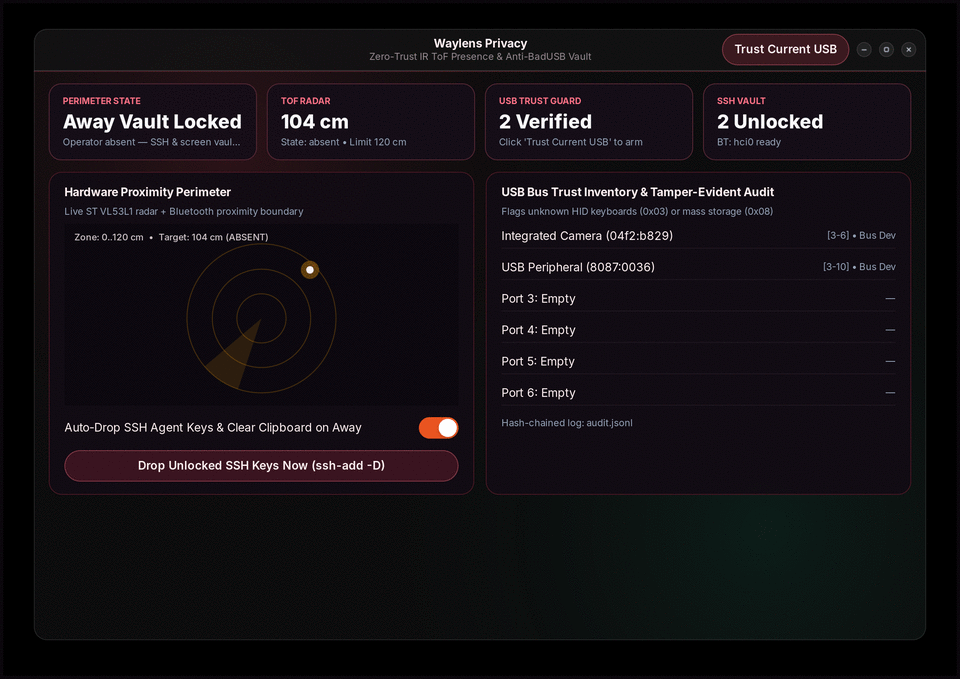

# waylens-privacy

Linux USB device baseline monitor and proximity-triggered SSH/clipboard lock helper in C and Python/GTK4.

<p align="center">
  
</p>

## What it does

- **`waylens-probe` (`src/native/vault_sensor.c`):** Enumerates `/sys/bus/usb/devices` (flagging HID `0x03` and Mass Storage `0x08` interfaces via `bInterfaceClass`), checks `/sys/class/bluetooth/hci0`, and reads ST VL53L1 presence distance from `/run/ff-power-manager/sensor_telemetry.json` when available.
- **USB Allowlist & Vault Actions (`src/waylens/vault.py`):** Compares attached USB devices against a user-saved JSON allowlist (`~/.local/share/waylens-privacy/trusted_usb.json`), can run `ssh-add -D` and clear the Wayland/X11 clipboard (`wl-copy --clear` / `xclip`), and appends SHA-256 hash-chained entries to `~/.local/share/waylens-privacy/audit.jsonl`.
- **UI (`src/waylens/gui.py`):** Displays presence state, connected USB inventory, active SSH keys, and recent audit events.

<details>
<summary>Static UI screenshot (overview.png)</summary>


</details>

## Build & Run

```bash
make all
make test
./waylens-probe --json
PYTHONPATH=src /usr/bin/python3 -m waylens.gui
```

## Related

[ff-power-manager](https://github.com/lwrlock/ff-power-manager) · [ebpf-latency-guard](https://github.com/lwrlock/ebpf-latency-guard) · [vram-atlas](https://github.com/lwrlock/vram-atlas) · [mempulse](https://github.com/lwrlock/mempulse) · [netpulse-bpf](https://github.com/lwrlock/netpulse-bpf) · [nvme-sentinel](https://github.com/lwrlock/nvme-sentinel)

## License & Development

MIT — see [LICENSE](LICENSE). Built by Furkan (`@lwrlock`) with AI coding assistance (Google DeepMind Antigravity) and verified on bare-metal Linux hardware.
