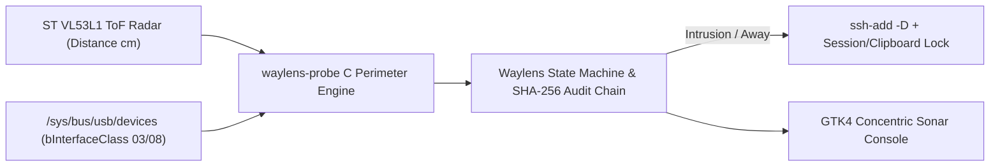
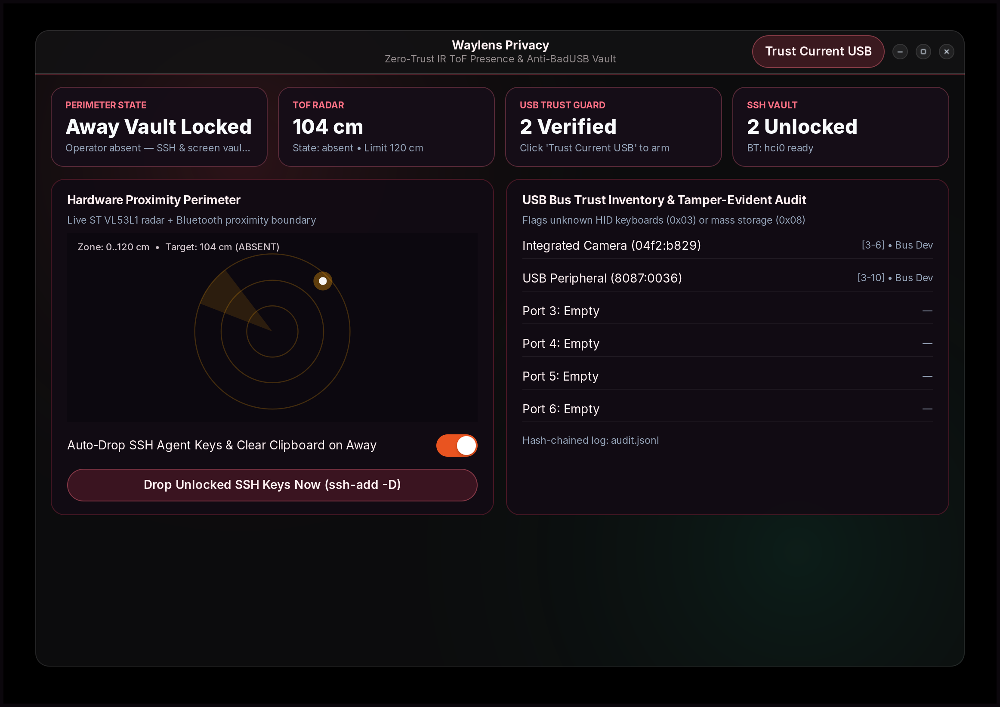

# Waylens Privacy

[](LICENSE)
[](#architecture)
[](#gallery)
[](https://github.com/lwrlock/ff-power-manager)

**Hardware-backed Linux Zero-Trust Proximity Vault & Anti-BadUSB Monitor combining ST VL53L1 IR ToF radar, USB interface class whitelisting (`HID`/`Mass Storage`), instant `ssh-agent` key dropping, and a SHA-256 hash-chained audit trail.**

<p align="center">
  
</p>

## Architecture



## Core Security Capabilities

- **Zero-Trust ToF Radar (`ST VL53L1`):** Tracks operator distance continuously without webcam access; locks session & arms the vault automatically on departure.
- **Anti-BadUSB / Rubber Ducky Guard:** Native C USB enumerator inspects `bInterfaceClass` across active ports and triggers `USB_INTRUSION_LOCK` on unknown HID keyboards (`0x03`) or storage (`0x08`).
- **One-Click SSH Agent & Clipboard Vault:** Drops unlocked SSH identities (`ssh-add -D`) and clears Wayland/X11 clipboard buffers cleanly.
- **Tamper-Evident Audit Chain:** Appends SHA-256 hash-linked JSONL records (`~/.local/share/waylens-privacy/audit.jsonl`, `0600`) for every perimeter state transition.

<details>
<summary><b>Full-Resolution UI Screenshot</b></summary>

<p align="center">
  
</p>

</details>

## Build & Run

```bash
make all && make test
./waylens-probe --json
PYTHONPATH=src /usr/bin/python3 -m waylens.gui
```

---

### FF Linux Kernel & Systems Suite
[FF Power Manager](https://github.com/lwrlock/ff-power-manager) · [eBPF Latency Guard](https://github.com/lwrlock/ebpf-latency-guard) · [VRAM Atlas](https://github.com/lwrlock/vram-atlas) · **Waylens Privacy** · [MemPulse](https://github.com/lwrlock/mempulse) · [NetPulse BPF](https://github.com/lwrlock/netpulse-bpf) · [NVMe Sentinel](https://github.com/lwrlock/nvme-sentinel)

MIT License — Copyright (c) 2026 Furkan (**lwrlock**). Built with assistance from Google DeepMind Antigravity.
